# Tiny CNC machine

A compact, three-axis CNC table designed in FreeCAD. Two stacked plates move on 8 mm guide rails, and a vertical drill head sits above the work surface.

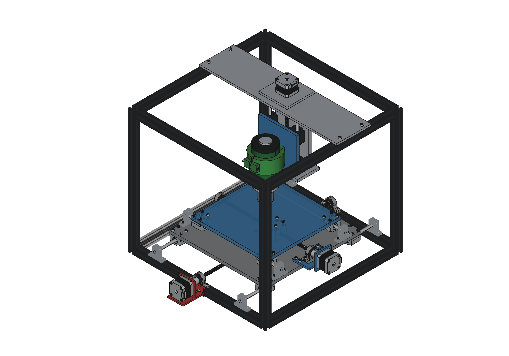

> **Project status:** design study and motion visualization. This is not a verified, build-ready machine.

## Why I'm building this

I got into robotics through 3D printing. Making parts at home is almost solved now. If you have a printer, you can download a model, slice it, and have a usable bracket or gear the same day.

CNC machines still feel like a different world. The good ones are expensive, the cheap ones are a project in themselves, and even after you buy one there is a lot to learn before you can make a clean part.

I wanted to build one from scratch. Partly to keep the cost down, but mostly because I wanted to understand what every part was doing. What actually holds an axis square? How does a lead screw move a plate? Where does the frame flex? Building it myself was the quickest way to find out.

This repository is my attempt at a small CNC that someone can recreate and assemble without a machine shop or a lot of prior CNC knowledge. It is still a work in progress. The prototype in the photos came together on the floor and at a drill press, with plenty of measuring, reprinting, and rethinking.

It all started with a what if.

## From the bench

| | |
| --- | --- |
| 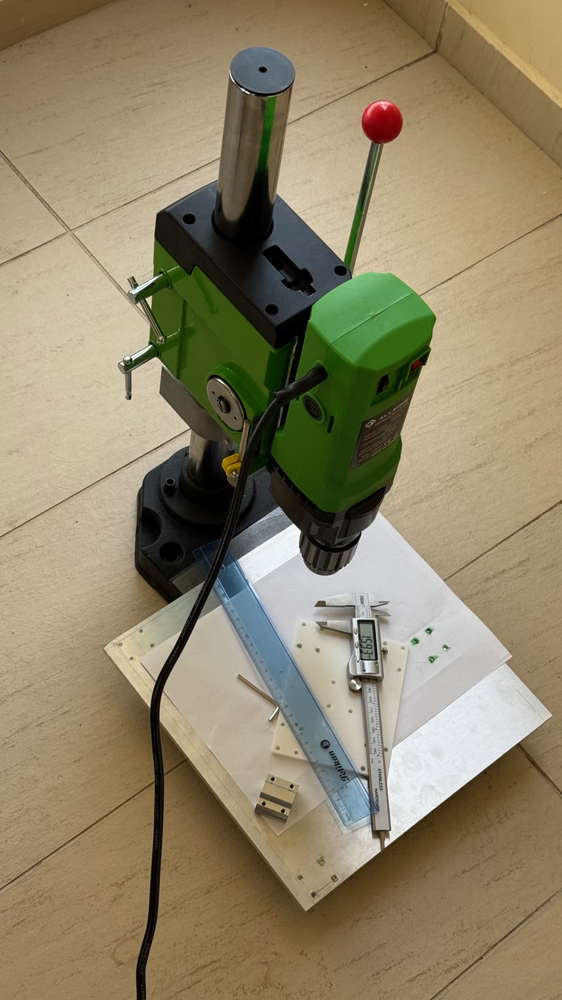 | 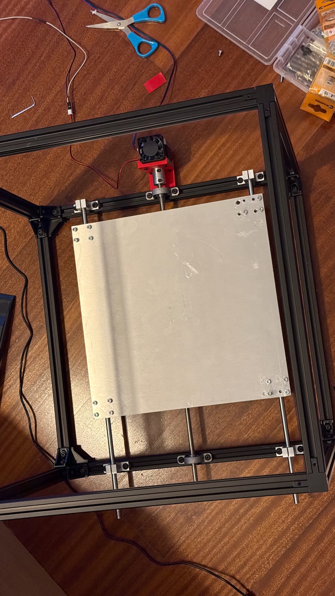 |
| 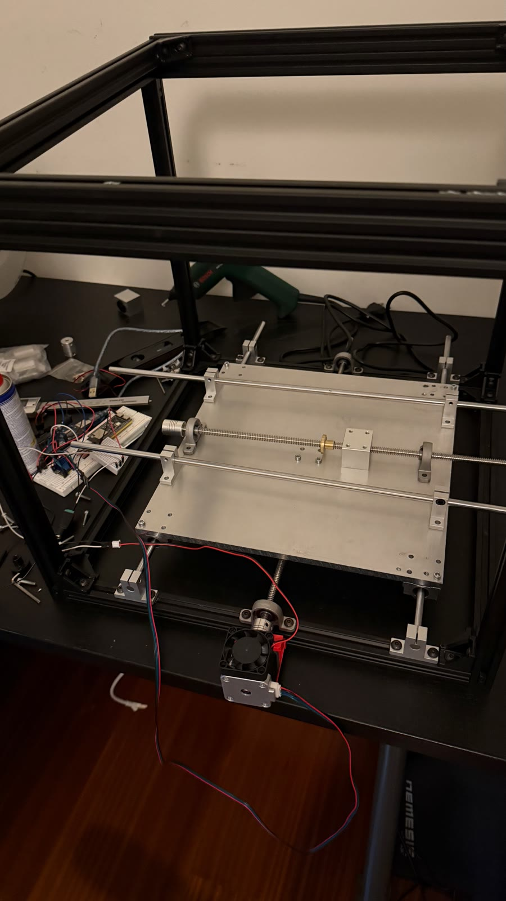 | 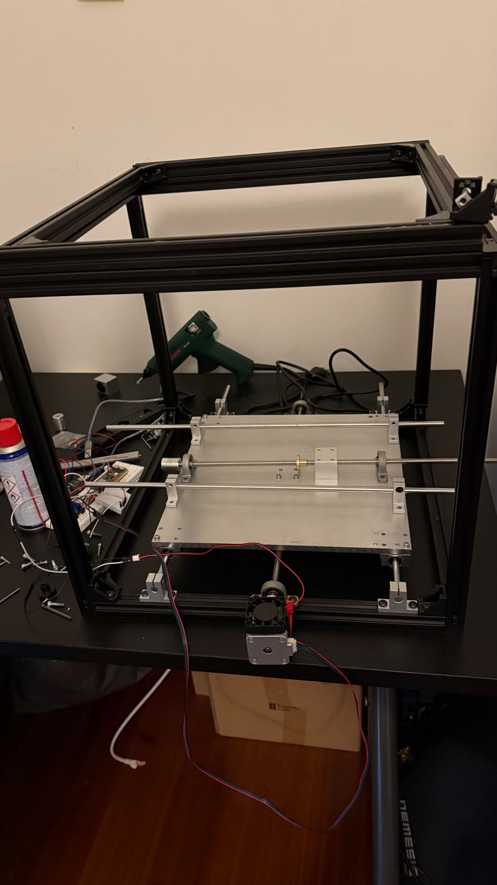 |
| 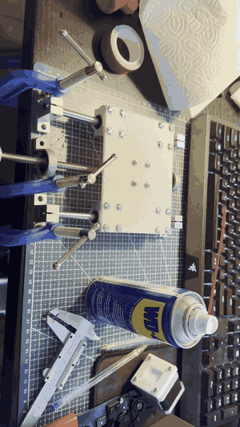 | 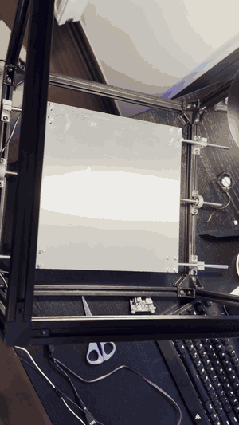 |

## How it works

The machine uses a stacked-axis layout:

- **Lower carriage (Y):** the gray lower plate rides on four SC8UU blocks on two fixed 8 mm guide rods. A lower M8 lead screw moves the carriage. Its NEMA 17 motor mounts to the front 2020 extrusion through a red printed bracket.
- **Upper table (X):** the blue upper plate rides on four SC8UU blocks on two 8 mm rods carried by the lower plate. A second M8 lead screw moves the upper table. Its NEMA 17 sits on a blue printed cantilever mount attached to the lower plate.
- **Drive train:** each motor connects to its lead screw through a 5-to-8 mm coupler. The screw is supported by two pillow blocks, and a nut block transfers the screw motion to the moving plate.
- **Z / drill head:** a 65 mm drill spindle rides on two vertical 8 mm rails above the table. A third NEMA 17 and a 150 mm M8 lead screw raise and lower it over 40 mm.
- **Frame:** twelve 400 mm 2020 aluminum extrusions form the enclosure. The visible finish is matte black.

## Parts

| Area | Parts | Purpose |
| --- | --- | --- |
| Frame | 12 × 2020 aluminum extrusion, corner brackets | Rigid structure and mounting datum |
| Lower guide rails | 2 × 8 mm smooth rods, 435 mm | Guide the Y carriage |
| Upper guide rails | 2 × 8 mm smooth rods, 308 mm | Guide the X table |
| Linear motion | 12 × SC8UU blocks | Low-friction carriage support |
| Lead screws | 3 × M8 threaded rods with nut blocks | Convert motor rotation into linear motion |
| Screw support | 4 × 8 mm pillow blocks and one 608 bearing | Hold the lead screws and resist thrust |
| Motors | 3 × NEMA 17, 5 mm shaft | X, Y, and Z actuation |
| Couplers | 3 × 5-to-8 mm couplers with set screws | Connect motor shafts to lead screws |
| Plates | Lower 307 × 306 × 9 mm; upper 240 × 238 × 9 mm | Moving platforms and component mounting surfaces |
| Fasteners | M3/M4 socket-head screws, M4 T-nuts, M4 hex nuts | Frame, motor, plate, bearing, and Z assembly |
| Printed parts | Red lower motor bracket; blue upper motor cantilever; green spindle clamp | Locate and retain the motors and drill |
| Z structure | 440 × 110 × 6 mm top deck, 2020 crossbar | Mount the vertical drill stage |
| Z guide rails | 2 × 8 mm rods, 182 mm | Guide the moving drill head |
| Z drive | 150 mm M8 lead screw, 608 bearing, NEMA 17, 5-to-8 mm coupler | Raise and lower the drill |
| Drill head | 65 mm spindle body, chuck, 6 mm bit | Drilling spindle |

The CAD model includes individual clearance holes for the plate-mounted sliders, bearing blocks, nut blocks, guide-rod supports, and the Z carriage.

## Design process

1. **Starting layout.** The first model established the 2020 frame and two stacked plates, but the upper plate and the complete drive layout were unfinished.
2. **Second layer.** The upper plate was brought forward and highlighted so both levels of the machine could be read clearly.
3. **Lead screws and motors.** The two M8 lead screws were trimmed and given NEMA 17 motors, couplers, pillow blocks, and initial motor mounts.
4. **Detailed hardware.** The placeholder motors were replaced with the detailed NEMA 17 CAD assembly already in the project. The mounts were rebuilt around the real motor faces and shafts. Socket-head screws were modeled with external threads, and matching holes, nuts, and extrusion T-nuts were added.
5. **Rails and plates.** All four smooth guide rods were trimmed to their support spacing. The plates were completed with mounting holes and fasteners for the sliders, guide supports, and nut blocks.
6. **Presentation.** The frame was given its matte-black finish, still views were rendered from multiple angles, and a short motion study was recorded.
7. **Z axis.** A bolted top deck, two vertical guide rails, a 150 mm lead screw, a NEMA 17 drive, and a 65 mm drill head were added above the existing table. The existing frame and carriages were left intact.

## Z axis / drill head

The drill head has 40 mm of vertical travel. It is shown at its low position with the 6 mm bit tip at Z 68 mm, 1 mm above the table. Raising the carriage moves the tip to Z 108 mm.

| Z drill head, low | Z drill head, raised |
| --- | --- |
| 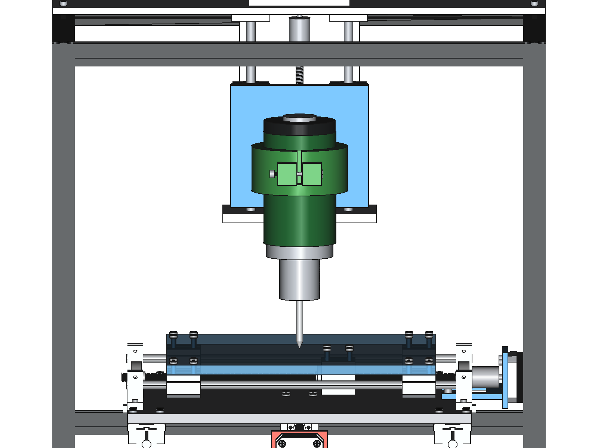 | 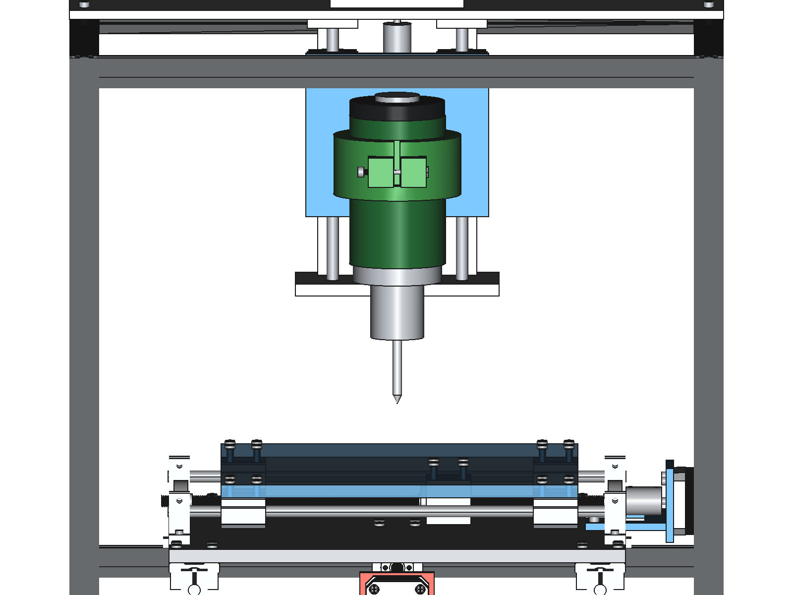 |

The drill body is a generic 65 mm spindle placeholder, not a model of a specific purchased drill. The Z carriage parts are grouped for editing but are not constrained or driven by an assembly mate in FreeCAD.

## Motion study

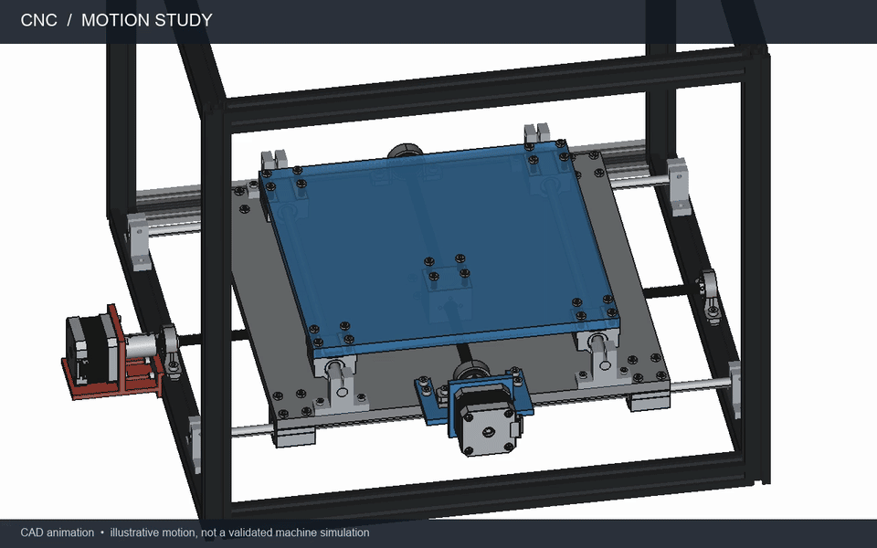

The GIF shows the upper plate moving in X, the lower carriage moving in Y, then both axes moving together. The lead screws rotate as their carriages translate. This is a kinematic illustration of the intended motion, not a collision-checked or physics-validated simulation.

## More views

| Lower drive | Upper drive |
| --- | --- |
| 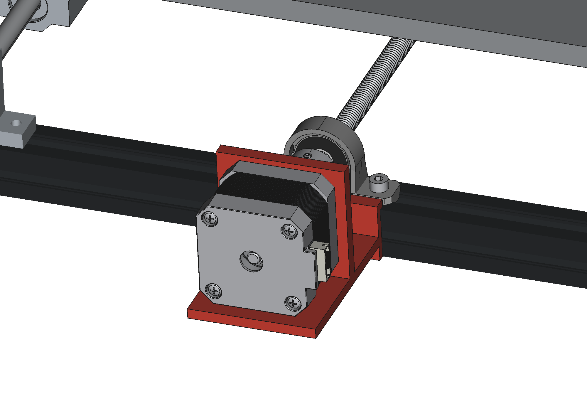 | 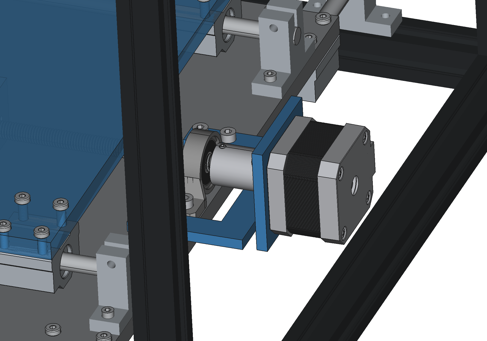 |

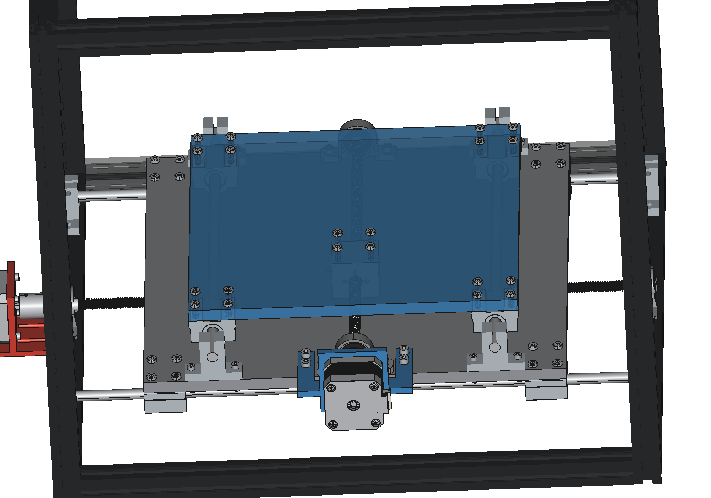

Additional views: [opposite angle](media/design-views/02-opposite-view.png) · [top](media/design-views/03-top-view.png) · [front](media/design-views/04-front-view.png)

## Repository contents

```text
cad/
  tiny_cnc_machine.FCStd     final FreeCAD assembly with X, Y, and Z
stl/
  tiny_cnc_assembly.stl      full assembly, reference mesh
  lower_motor_mount.stl      printed lower bracket, provisional
  upper_motor_mount.stl      printed upper cantilever, provisional
media/
  actuator-motion.gif        animated X/Y motion study
  design-views/              CAD still renders
  physical/                  photos and GIFs from the physical build
```

The FreeCAD model is a flattened final assembly: each visible component is a separate solid or mesh, grouped under **Frame**, **Lower carriage**, **Upper table**, **Drives and motors**, and **Z axis / drill head**. Open it with FreeCAD 1.0 or newer; all dimensions are in millimeters. The assembly STL is a visualization/reference mesh, not a single printable object.
